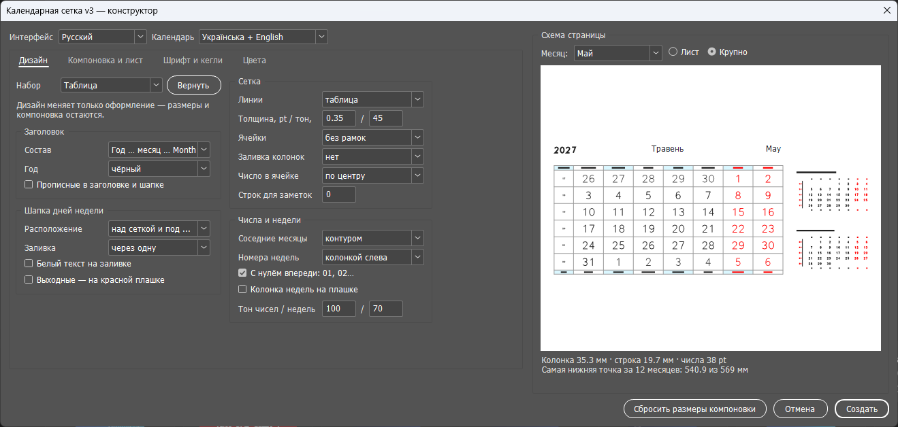
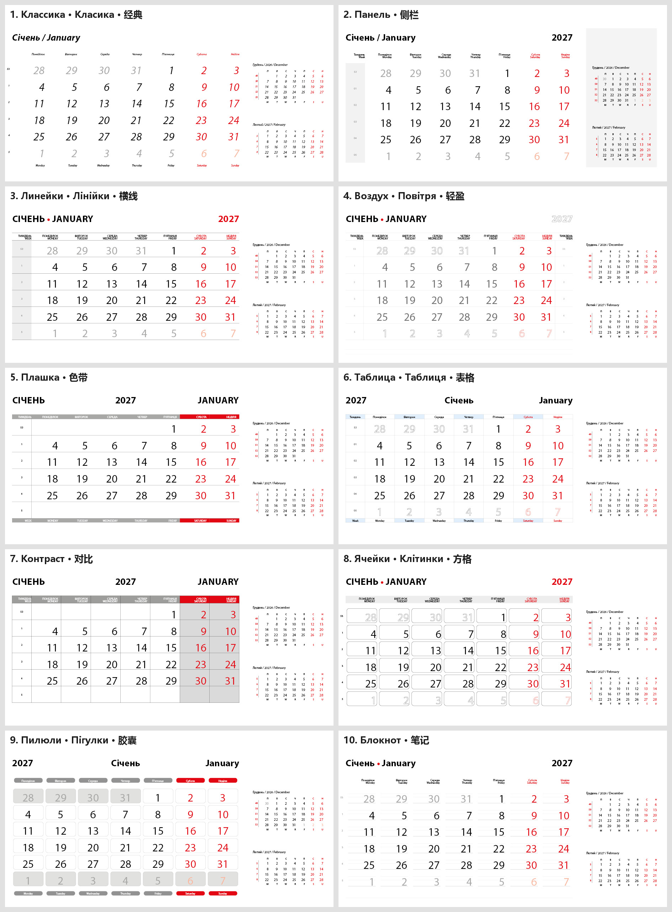
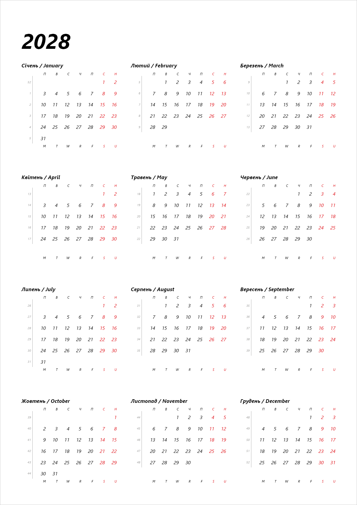

# indesign-calendar-grid-builder — v3.1

Скрипт для InDesign, який будує календарну сітку на будь-який рік або на
будь-який проміжок місяців, по місяцю на сторінку. Оформлення живе в стилях документа,
тож його потім можна змінювати глобально, без перезапуску.

[По-русски → README.ruRU.md](README.ruRU.md) · [中文说明 → README.zhCN.md](README.zhCN.md)

## Верстка календарної сітки — це та задача, де нудно і водночас страшно помилитися

Нудно, бо це 12 однакових сторінок. Страшно, бо помилку в одній даті знайде не
коректор, а клієнт — уже після друку тиражу.

Тому скрипт рахує сітку сам. У сітці на 2027 рік перший тиждень січня — 53-й,
бо він належить ще 2026 року. Такі речі руками не рахують, їх або знають, або
помиляються.

## Що нового у v3 і v3.1

→ **Один скрипт замість двох.** Українська гілка і гілка RU/ZH об'єднані в
`calendargridbuilder_v3_1.jsx`. Інтерфейс — українська, русский або 中文.
Календар — українська, русский або 中文, завжди в парі з English. Мови
незалежні одна від одної.

→ **Десять дизайнів.** Компонування (де стоять міні-календарі) і дизайн (як усе
намальовано) тепер обираються окремо. Будь-яку деталь дизайну можна перемкнути
вручну.

→ **Нова схема сторінки.** Схема малює саме те, що піде в документ: справжні
числа в точний кегль, жирні й контурні цифри, плашки, лінії, скруглені рамки.
Режим «Крупно» показує блок календаря на всю ширину, режим «Аркуш» — сторінку
цілком разом із фреймом під фото.

→ **Швидкий запуск.** Список шрифтів тепер читається за частки секунди. У v2 один
пошкоджений шрифт у системі міг розтягнути відкриття діалогу на півтори хвилини.

→ **Фрейм під фото.** Над сіткою на кожній сторінці з'являється порожній
графічний фрейм. Він однакового розміру на всіх сторінках, навіть якщо блок
прив'язаний до низу.

→ **Діапазон місяців (v3.1).** Календар не обов'язково йде з січня по грудень: задаєте
місяць і рік початку та кількість місяців, від 1 до 24. Наприклад, «грудень 2026,
13 місяців» дає перекидний з грудня по грудень. Рік у заголовку кожної сторінки
свій, міні-календарі й номери тижнів коректно переходять через Новий рік.

→ **Наступний рік цілком (v3.1).** Остання сторінка — увесь наступний рік: великий рік
угорі й дванадцять місяців сіткою. Детальніше — нижче.

→ **Компактний діалог.** Налаштування розкладені по вкладках, вікно вміщається на
екран 1366 × 768.

## Дизайни

| №  | Набір     | Що в ньому |
|----|-----------|------------|
| 1  | Класика   | як у v2: без ліній, дні тижня над сіткою і під нею, курсив |
| 2  | Панель    | міні-календарі на сірій плашці, двохрядкова шапка, колонка тижнів на плашці |
| 3  | Лінійки   | лінійки між рядками, червоний рік, колонка тижнів на плашці |
| 4  | Повітря   | сірі числа, сусідні дні й рік контуром, тижні з двох боків, рядки для нотаток |
| 5  | Плашка    | темна плашка шапки з білим текстом, вихідні на червоному |
| 6  | Таблиця   | тонка таблиця, шапка через одну, контурні сусідні дні |
| 7  | Контраст  | жирна таблиця, залиті колонки вихідних, числа в правому нижньому куті |
| 8  | Клітинки  | кожне число в скругленій рамці, сусідні дні контуром |
| 9  | Пігулки   | шапка «пігулками», рамки клітинок, сусідні дні на сірих плашках |
| 10 | Блокнот   | лінійки для записів у кожній клітинці, числа в куті |

На вкладці «Дизайн» перемикається кожна деталь окремо:

- **заголовок** — «Місяць / Month», з роком праворуч, через червону крапку, рік
  по центру або ліворуч, рік в обох кутах; рік чорний, червоний або контуром;
- **шапка днів тижня** — над сіткою і під нею або двома рядками над сіткою;
  заливка суцільною плашкою, через одну або «пігулками»; білий текст; вихідні
  на червоній плашці;
- **сітка** — без ліній, лінійки між рядками, таблиця, лінійки для записів у
  клітинках; товщина і тон ліній; скруглені рамки; заливка колонок вихідних або
  через одну; число праворуч, по центру або в правому нижньому куті; рядки для
  нотаток під сіткою;
- **числа і тижні** — сусідні місяці не показувати, блідим кольором або
  контуром; номери тижнів у полі, колонкою ліворуч, з двох боків або не
  показувати; нуль попереду (01, 02…); колонка тижнів на плашці; тон чисел.

Зміна набору не чіпає розміри й компонування. Шрифт обирається як і раніше — зі
встановлених у системі; шрифти на прикладах умовні.

Вихідними вважаються субота і неділя. Свята скрипт не позначає.

## Компонування

Три компонування з v2 з їхніми вивіреними кеглями й відступами:

- **Міні під сіткою** — сітка на всю ширину, міні-календарі сусідніх місяців під нею;
- **Міні поруч** — сітка 65 % ширини, два міні в ряд збоку;
- **Міні стовпчиком** — сітка 73 % ширини, міні один під одним збоку.

Нове у v3: міні-календарі можна поставити **ліворуч**, підкласти під них
**плашку** і показати в них **числа сусідніх місяців**.

Як і раніше: формат аркуша, поля, частка ширини під сітку, прив'язка блоку до
верху або до низу, «завжди 6 рядків», кнопка «Підігнати під аркуш», яка
перераховує пресет під A3, A4 або власний розмір.

## Сторінка «рік цілком»

Галочка «Остання сторінка — рік цілком» на вкладці «Компонування і аркуш»
додає в кінець документа ще одну сторінку з наступним роком. Календар на 2027
закінчується сторінкою 2028.

- **Рік підставляється сам** — той, що йде за календарем. Для «грудень 2026,
  13 місяців» це теж 2028, для «липень 2027 — червень 2028» — 2028. Можна
  вписати свій рік, і тоді він уже не змінюється разом із діапазоном.
- **Розкладка підбирається під аркуш**: 3 × 4 на книжному, 4 × 3 на
  альбомному. Кеглі рахуються з ширини колонки, тож сторінка однаково
  виглядає на A2 і на A4.
- **Оформлення бере з дизайну**: колір і контур року, капітель назв, плашки
  й сусідні дні — як у міні-календарів, номери тижнів — якщо вони є в дизайні.
- На схемі в діалозі ця сторінка — останній пункт у списку місяців.

Якщо на маленькому аркуші числа виходять дрібніше 6 pt, скрипт попередить.

## Перевірка геометрії

Перед створенням документа скрипт прораховує всі місяці діапазону і попереджає
конкретикою: «Блок виходить за нижнє поле на 4.8 мм (Травень 2027)». Зведення — під схемою.

## Стилі в документі

Усе оформлення — у стилях групи `CAL`. Змінили стиль — змінилися всі сторінки.

- **Paragraph Styles → CAL** — кегль, шрифт, колір, виключка: `Month title`,
  `Year`, `Weekday UA`/`RU`/`ZH`, `Weekday EN`, `Day`, `Day red`,
  `Day adjacent`, `Week no`, `Mini …`, `Year page …` (сторінка року).
- **Object Styles → CAL** — заливки, лінії, рамки: `CAL Head band`,
  `CAL Head cell`, `CAL Head weekend`, `CAL Head pill`, `CAL Column fill`,
  `CAL Week column`, `CAL Rule`, `CAL Rule notes`, `CAL Day box`,
  `CAL Day box adjacent`, `CAL Mini panel`, `CAL Mini rule`, `CAL Photo`.
  Наприклад, радіус скруглення всіх клітинок змінюється в одному `CAL Day box`.
- **Character Styles → CAL** — `Red` (червона крапка в заголовку), `CJK` і
  `CJK bold` (ієрогліфи).
- **Swatches** — `CAL Red` і `CAL Fill` (колір плашок і заливок дизайну).

Створюються лише ті стилі, які справді використані.

## Про схему сторінки

ScriptUI в InDesign малює текст на схемі лише системним шрифтом одного розміру
(перевірено в InDesign 2026). Тому:

- числа на схемі — власні векторні цифри, у точний кегль, жирні, курсивні й
  контурні, як у документі;
- назви місяців — системним шрифтом;
- дрібні підписи (дні тижня, номери тижнів на аркуші цілком) — смужками.

Плашки, лінії, рамки, заливки й кольори на схемі — ті самі, що в документі.

## Системні вимоги

Крім самого InDesign не потрібно нічого: ні плагінів, ні розширень, ні інтернету.

## Шрифти

Шрифт обирається в діалозі зі справді встановлених. Якщо не обрано, скрипт
бере перший доступний із переліку:

    Myriad Pro → Segoe UI → Roboto → Arial → Helvetica

Кожен кандидат скрипт пробно призначає перед збиранням: InDesign 2026 може
мовчки підмінити Myriad Pro на Acumin Variable Concept, у якому немає
кирилиці. Такий шрифт пропускається, і береться наступний зі списку.

Дизайн «Класика» віддає перевагу курсивному накресленню, як у v2, решта —
прямому. Для китайського календаря додатково потрібен шрифт з ієрогліфами —
див. [README.zhCN.md](README.zhCN.md).

## Файл налаштувань

Зберігає параметри між запусками: діапазон місяців, сторінку року, компонування,
дизайн, мови, розміри й кольори.

- Windows: `%APPDATA%\CalendarGridBuilder3.txt`
- macOS: `~/Library/Application Support/CalendarGridBuilder3.txt`

Ім'я відрізняється від v2 — налаштування старих скриптів не затираються. Якщо
записати не вдасться, скрипт просто працюватиме без пам'яті між сесіями.

## Що скрипт робить

1. Створює новий документ. Відкриті документи не чіпає.
2. Не зберігає файлів, окрім файла налаштувань.
3. Не звертається до мережі.
4. Нічого не встановлює і не змінює налаштувань InDesign.

Уся побудова — один крок скасування: Ctrl+Z / Cmd+Z прибирає все одразу.

## Встановлення в InDesign

1. Відкрийте панель скриптів: **Window → Utilities → Scripts**.
2. Натисніть на папку **User** правою кнопкою миші та виберіть
   **Reveal in Explorer** (Windows) або **Reveal in Finder** (macOS).
3. Відкрийте папку **Scripts Panel** і скопіюйте в неї файл
   `calendargridbuilder_v3_1.jsx`.
4. Поверніться до InDesign: **User → Scripts Panel**, подвійний клік по файлу.

Перезапускати InDesign не потрібно — файл підхоплюється одразу.

Оновлюєтеся з v3.0 — видаліть із папки старий `calendargridbuilder_v3_0.jsx`.
Налаштування збережуться: файл налаштувань у v3.1 той самий.

Файли v2 (`calendargridbuilder_v2_2_betta.jsx` і
`calendargridbuilder_ru_zh_v2_2_beta.jsx`) поки лежать поруч і працюють як раніше.
