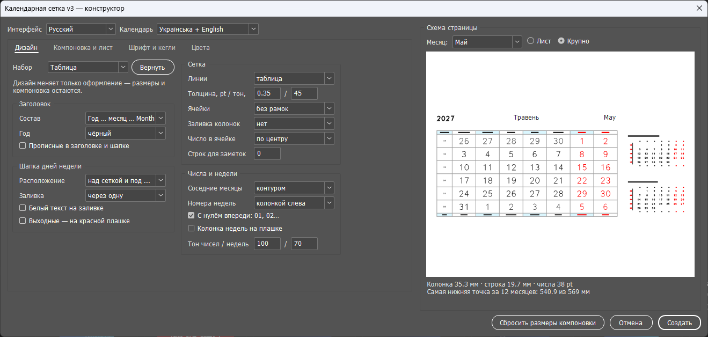
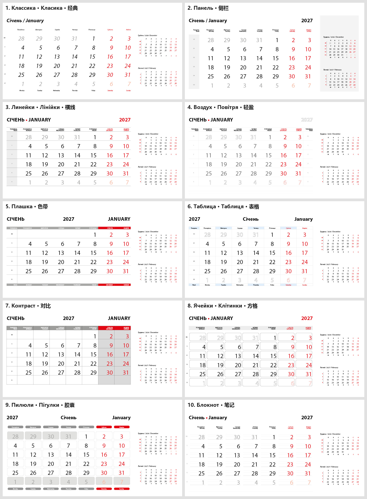

# Календарная сетка для InDesign — v3

Скрипт для InDesign, который строит календарную сетку на любой год или на
любой промежуток месяцев, по месяцу на страницу. Оформление живёт в стилях документа,
поэтому его потом можно менять глобально, без перезапуска.

[Українською → README.md](README.md) · [中文说明 → README.zhCN.md](README.zhCN.md)

## Вёрстка календарной сетки — та задача, где скучно и одновременно страшно ошибиться

Скучно, потому что это 12 одинаковых страниц. Страшно, потому что ошибку в одной
дате найдёт не корректор, а клиент — уже после печати тиража.

Поэтому скрипт считает сетку сам. В сетке на 2027 год первая неделя января —
53-я, потому что принадлежит ещё 2026 году. Такие вещи руками не считают, их либо
знают, либо ошибаются.

## Что нового в v3

→ **Один скрипт вместо двух.** Украинская ветка и ветка RU/ZH объединены в
`calendargridbuilder_v3_0.jsx`. Интерфейс — українська, русский или 中文.
Календарь — українська, русский или 中文, всегда в паре с English.
Языки независимы: русский интерфейс и китайская сетка — обычный случай в
типографии.

→ **Десять дизайнов.** Компоновка (где стоят мини-календари) и дизайн (как всё
нарисовано) теперь выбираются отдельно. Любую деталь дизайна можно переключить
вручную.

→ **Новая схема страницы.** Схема рисует ровно то, что уйдёт в документ:
настоящие числа в точный кегль, жирные и контурные цифры, плашки, линии,
скруглённые рамки. Режим «Крупно» показывает блок календаря на всю ширину,
режим «Лист» — страницу целиком вместе с фреймом под фото.

→ **Быстрый запуск.** Список шрифтов теперь читается за доли секунды. В v2 один
повреждённый шрифт в системе мог растянуть открытие диалога на полторы минуты.

→ **Фрейм под фото.** Над сеткой на каждой странице появляется пустой графический
фрейм. Он одного размера на всех страницах, даже если блок привязан к низу.

→ **Диапазон месяцев.** Календарь не обязательно идёт с января по декабрь:
задаёте месяц и год начала и число месяцев, от 1 до 24. Например, «декабрь 2026,
13 месяцев» даёт перекидной с декабря по декабрь. Год в заголовке каждой страницы
свой, мини-календари и номера недель корректно переходят через Новый год.

→ **Компактный диалог.** Настройки разложены по вкладкам, и окно помещается на
экран 1366 × 768.

## Дизайны

| №  | Набор     | Что в нём |
|----|-----------|-----------|
| 1  | Классика  | как в v2: без линий, дни недели над сеткой и под ней, курсив |
| 2  | Панель    | мини-календари на серой плашке, двухстрочная шапка, колонка недель на плашке |
| 3  | Линейки   | линейки между строками, красный год, колонка недель на плашке |
| 4  | Воздух    | серые числа, соседние дни и год контуром, недели с двух сторон, строки для заметок |
| 5  | Плашка    | тёмная плашка шапки с белым текстом, выходные на красном |
| 6  | Таблица   | тонкая таблица, шапка через одну, контурные соседние дни |
| 7  | Контраст  | жирная таблица, залитые колонки выходных, числа в правом нижнем углу |
| 8  | Ячейки    | каждое число в скруглённой рамке, соседние дни контуром |
| 9  | Пилюли    | шапка «пилюлями», рамки ячеек, соседние дни на серых плашках |
| 10 | Блокнот   | линейки для записей в каждой ячейке, числа в углу |

На вкладке «Дизайн» переключается каждая деталь отдельно:

- **заголовок** — «Месяц / Month», с годом справа, через красную точку, год
  по центру или слева, год в обоих углах; год чёрный, красный или контуром;
- **шапка дней недели** — над сеткой и под ней или двумя строками над сеткой;
  заливка сплошной плашкой, через одну или «пилюлями»; белый текст; выходные на
  красной плашке;
- **сетка** — без линий, линейки между строками, таблица, линейки для записей
  в ячейках; толщина и тон линий; скруглённые рамки; заливка колонок выходных
  или через одну; число справа, по центру или в правом нижнем углу; строки для
  заметок под сеткой;
- **числа и недели** — соседние месяцы не показывать, бледным цветом или
  контуром; номера недель в поле, колонкой слева, с двух сторон или не
  показывать; ведущий ноль (01, 02…); колонка недель на плашке; тон чисел.

Смена набора не трогает размеры и компоновку. Шрифт выбирается как раньше —
из установленных в системе; шрифты на примерах условные.

Выходными считаются суббота и воскресенье. Праздники скрипт не отмечает.

## Компоновки

Три компоновки из v2 с их выверенными кеглями и отступами:

- **Мини под сеткой** — сетка на всю ширину, мини-календари соседних месяцев под ней;
- **Мини рядом** — сетка 65 % ширины, два мини в ряд сбоку;
- **Мини столбиком** — сетка 73 % ширины, мини один под другим сбоку.

Новое в v3: мини-календари можно поставить **слева**, подложить под них
**плашку** и показать в них **числа соседних месяцев**.

Как и раньше: формат листа, поля, доля ширины под сетку, привязка блока к верху
или к низу, «всегда 6 строк», кнопка «Подогнать под лист», которая
пересчитывает пресет под A3, A4 или свой размер.

## Проверка геометрии

Перед созданием документа скрипт просчитывает все месяцы диапазона и предупреждает
конкретикой: «Блок выходит за нижнее поле на 4.8 мм (Май 2027)». Сводка — под схемой.

## Стили в документе

Всё оформление — в стилях группы `CAL`. Поменяли стиль — поменялись все страницы.

- **Paragraph Styles → CAL** — кегль, шрифт, цвет, выключка: `Month title`,
  `Year`, `Weekday UA`/`RU`/`ZH`, `Weekday EN`, `Day`, `Day red`,
  `Day adjacent`, `Week no`, `Mini …`.
- **Object Styles → CAL** — заливки, линии, рамки: `CAL Head band`,
  `CAL Head cell`, `CAL Head weekend`, `CAL Head pill`, `CAL Column fill`,
  `CAL Week column`, `CAL Rule`, `CAL Rule notes`, `CAL Day box`,
  `CAL Day box adjacent`, `CAL Mini panel`, `CAL Mini rule`, `CAL Photo`.
  Например, радиус скругления всех ячеек меняется в одном `CAL Day box`.
- **Character Styles → CAL** — `Red` (красная точка в заголовке), `CJK` и
  `CJK bold` (иероглифы).
- **Swatches** — `CAL Red` и `CAL Fill` (цвет плашек и заливок дизайна).

Создаются только те стили, которые реально использованы.

## Китайская сетка

Названия месяцев — 一月 … 十二月, дни недели — 星期一 … 星期日, сокращённые в
мини-календарях — 一 二 三 四 五 六 日. Английская строка остаётся (Monday … Sunday).

**Два шрифта.** Цифры и латиница набираются основным шрифтом, иероглифы —
отдельным китайским (знаковые стили `CJK` и `CJK bold`). При китайском
календаре в диалоге появляется вторая пара полей — «Шрифт иероглифов» и его
начертания; опознанные китайские семейства идут в списке первыми.

## О схеме страницы

ScriptUI в InDesign рисует текст на схеме только системным шрифтом одного
размера (проверено в InDesign 2026). Поэтому:

- числа на схеме — собственные векторные цифры, в точный кегль, жирные,
  курсивные и контурные, как в документе;
- названия месяцев — системным шрифтом;
- мелкие подписи (дни недели, номера недель на листе целиком) — полосками.

Плашки, линии, рамки, заливки и цвета на схеме — те же, что в документе.

## Системные требования

Кроме самого InDesign не нужно ничего: ни плагинов, ни расширений, ни интернета.

## Шрифты

Шрифт выбирается в диалоге из реально установленных. Если не выбран, скрипт
берёт первый доступный из списка:

    Myriad Pro → Segoe UI → Roboto → Arial → Helvetica

Дизайн «Классика» предпочитает курсивное начертание, как в v2, остальные —
прямое. Для китайского календаря дополнительно нужен шрифт с иероглифами:

    Source Han Sans SC → Noto Sans SC → Noto Sans CJK SC
    → Source Han Serif SC → Noto Serif SC
    → Microsoft YaHei (微软雅黑) → PingFang SC → Hiragino Sans GB
    → Heiti SC → SimHei (黑体) → SimSun (宋体)
    → Adobe Song Std → Adobe Heiti Std

## Файл настроек

Сохраняет параметры между запусками: диапазон месяцев, компоновку, дизайн, языки,
размеры и цвета.

- Windows: `%APPDATA%\CalendarGridBuilder3.txt`
- macOS: `~/Library/Application Support/CalendarGridBuilder3.txt`

Имя отличается от v2 — настройки старых скриптов не затираются. Если записать
не удастся, скрипт просто поработает без памяти между сессиями.

## Что скрипт делает

1. Создаёт новый документ. Открытые документы не трогает.
2. Не сохраняет файлов, кроме файла настроек.
3. Не обращается к сети.
4. Ничего не устанавливает и не меняет настроек InDesign.

Всё построение — один шаг отмены: Ctrl+Z / Cmd+Z убирает всё сразу.

## Установка в InDesign

1. Откройте панель скриптов: **Window → Utilities → Scripts**.
2. Нажмите на папку **User** правой кнопкой мыши и выберите
   **Reveal in Explorer** (Windows) или **Reveal in Finder** (macOS).
3. Откройте папку **Scripts Panel** и скопируйте в неё файл
   `calendargridbuilder_v3_0.jsx`.
4. Вернитесь в InDesign: **User → Scripts Panel**, двойной щелчок по файлу.

Перезапускать InDesign не нужно — файл подхватывается сразу.

Файлы v2 (`calendargridbuilder_v2_2_betta.jsx` и
`calendargridbuilder_ru_zh_v2_2_beta.jsx`) пока лежат рядом и работают как раньше.
