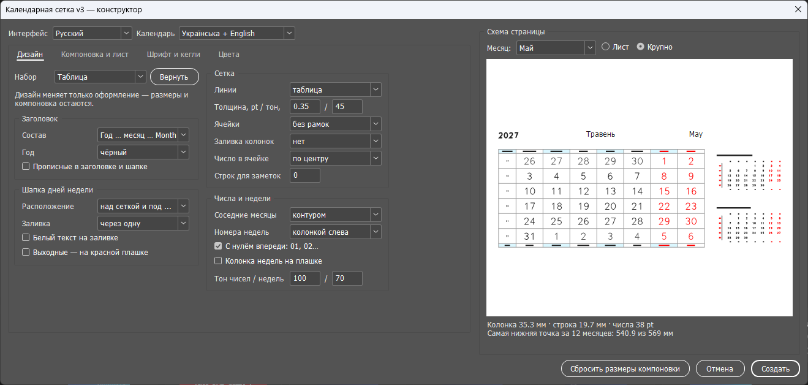
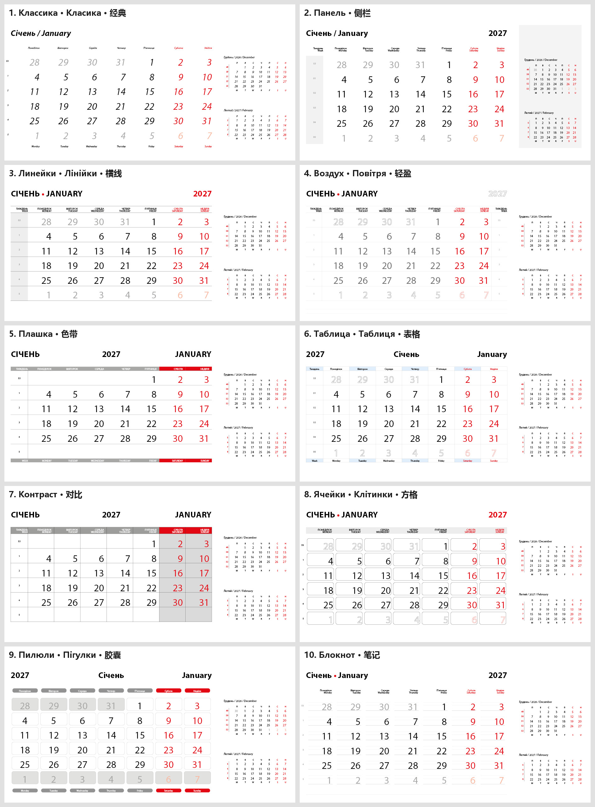

# InDesign 日历网格生成器 — v3

用于 Adobe InDesign 的脚本，可为任意年份或任意连续月份生成日历网格，每页一个月。
外观全部写在文档样式里，之后可以全局修改，无需重新运行脚本。

[Українською → README.md](README.md) · [По-русски → README.ruRU.md](README.ruRU.md)

## 排一套日历网格，既枯燥又容易出事

枯燥，是因为要做 12 个几乎一样的页面。容易出事，是因为某一个日期排错了，
发现的人往往不是校对，而是客户 —— 而那时整批已经印完了。

所以让脚本自己算。2027 年的网格里，一月的第一周是第 53 周，因为它仍属于
2026 年。这类事情没人靠手算，要么知道，要么出错。

## v3 新功能

→ **两个脚本合而为一。** 乌克兰文分支与俄文 / 中文分支合并为
`calendargridbuilder_v3_0.jsx`。界面语言可选 українська、русский 或 中文；
日历语言可选 українська、русский 或 中文，均与英文搭配。两者可以自由组合
—— 用俄文界面排中文日历，在印厂是常见情形。

→ **十种设计。** 「版式」（小月历放在哪里）与「设计」（如何绘制）现在分开
选择。设计中的每个细节都可以单独切换。

→ **全新的页面示意图。** 示意图绘制的正是将要生成的内容：按实际字号绘制的
数字，粗体与描边数字，色带、线条、圆角边框。「放大」模式让日历版块占满宽度，
「整页」模式显示整页及图片框。

→ **启动更快。** 字体列表现在只需零点几秒即可读取。在 v2 中，系统里只要有一款
损坏的字体，打开对话框就可能要等一分半钟。

→ **图片框。** 每页网格上方都会放置一个空的图片框。即使版块底对齐，所有页面上的
图片框大小也完全一致。

→ **月份范围。** 日历不必从一月排到十二月：可以设置起始月份、起始年份和月数
（1 至 24）。例如「2026 年十二月，13 个月」即得到从十二月到十二月的挂历。
每页标题中的年份各自对应，小月历和周次跨年时同样正确。

→ **紧凑的对话框。** 设置分布在选项卡中，窗口可以完整显示在 1366 × 768 的屏幕上。

## 十种设计

| 编号 | 方案 | 特点 |
|------|------|------|
| 1  | 经典 | 与 v2 相同：无线条，星期在网格上方和下方，斜体 |
| 2  | 侧栏 | 小月历位于灰色底板上，两行表头，周次列加底色 |
| 3  | 横线 | 行间横线，红色年份，周次列加底色 |
| 4  | 轻盈 | 灰色日期，相邻日期与年份为描边，两侧周次，备注行 |
| 5  | 色带 | 深色表头色带配白字，周末为红色 |
| 6  | 表格 | 细线表格，表头隔格填色，相邻日期为描边 |
| 7  | 对比 | 粗线表格，周末列填色，日期位于右下角 |
| 8  | 方格 | 每个日期一个圆角边框，相邻日期为描边 |
| 9  | 胶囊 | 「胶囊」式表头，单元格边框，相邻日期在灰色底上 |
| 10 | 笔记 | 每个单元格内有书写线，日期位于角落 |

在「设计」选项卡中可以单独切换每个细节：标题组成与年份样式；星期表头的位置、
底色、白字、周末红底；网格线条、粗细与色调、圆角边框、列填色、日期位置、
备注行数；相邻月份日期的显示方式、周次位置、补零、周次列底色、日期色调。

切换方案不会改变尺寸和版式。字体仍从系统已安装的字体中选择；示例中的字体
仅供参考。

周末仅指星期六和星期日，脚本不标注节假日。

## 版式

沿用 v2 的三种版式及其调校好的字号与间距：小月历在网格下方、小月历并排在
侧面、小月历竖排在侧面。

v3 新增：小月历可以放在**左侧**，可以加**底色**，也可以显示**相邻月份的日期**。

## 文档中的样式

所有外观都在 `CAL` 样式组中。修改样式，所有页面随之改变。

- **段落样式 → CAL**：字号、字体、颜色、对齐。
- **对象样式 → CAL**：色带、线条、边框，例如 `CAL Day box` 中的圆角半径
  决定全部单元格。
- **字符样式 → CAL**：`Red`（标题中的红点）、`CJK` 与 `CJK bold`（汉字）。
- **色板**：`CAL Red` 与 `CAL Fill`（设计中的底色）。

只创建实际用到的样式。

## 中文日历

月份为 一月 … 十二月，星期为 星期一 … 星期日，小月历中的缩写为
一 二 三 四 五 六 日。英文一行保持不变（Monday … Sunday）。

**两套字体。** 数字与拉丁字母使用正文字体，汉字使用单独的中文字体
（字符样式 `CJK` 与 `CJK bold`）。选择中文日历时，对话框中会出现「中文字体」
及其字重；已识别为中文的字体族排在列表前列。

## 关于页面示意图

InDesign 的 ScriptUI 在示意图上只能用系统字体、以同一字号绘制文字
（已在 InDesign 2026 中验证）。因此：

- 示意图中的数字是脚本自带的矢量数字，字号、粗体、斜体与描边都与文档一致；
- 月份名称使用系统字体；
- 很小的文字（星期名称、整页模式下的周次）以色条表示。

色带、线条、边框、填色与颜色都与文档完全一致。

## 系统要求

除 InDesign 本身外无需任何东西：不需要插件、扩展或网络连接。

## 字体

在对话框中从实际安装的字体里选择。如未选择，脚本按以下顺序取第一款可用的：

    Myriad Pro → Segoe UI → Roboto → Arial → Helvetica

「经典」方案优先使用斜体，与 v2 一致；其余方案使用正体。中文日历还需要一款
含汉字的字体：

    Source Han Sans SC → Noto Sans SC → Noto Sans CJK SC
    → Source Han Serif SC → Noto Serif SC
    → 微软雅黑 (Microsoft YaHei) → PingFang SC → Hiragino Sans GB
    → Heiti SC → 黑体 (SimHei) → 宋体 (SimSun)
    → Adobe Song Std → Adobe Heiti Std

## 设置文件

在两次运行之间保存月份范围、版式、设计、语言、尺寸与颜色：

- Windows：`%APPDATA%\CalendarGridBuilder3.txt`
- macOS：`~/Library/Application Support/CalendarGridBuilder3.txt`

文件名与 v2 不同，旧脚本的设置不会被覆盖。如果无法写入，脚本只是不记住设置，
不会报错。

## 脚本会做什么

1. 新建一个文档，不触碰已打开的文档。
2. 除设置文件外不保存任何文件。
3. 不访问网络。
4. 不安装任何东西，也不修改 InDesign 的设置。

全部生成过程为一步撤销：Ctrl+Z / Cmd+Z 一次即可全部还原。

## 在 InDesign 中安装

1. 打开脚本面板：**Window → Utilities → Scripts**。
2. 右键单击 **User** 文件夹，选择 **Reveal in Explorer**（Windows）或
   **Reveal in Finder**（macOS）。
3. 打开 **Scripts Panel** 文件夹，将 `calendargridbuilder_v3_0.jsx` 复制进去。
4. 回到 InDesign：**User → Scripts Panel**，双击该文件即可运行。

无需重启 InDesign，文件会立即生效。

v2 的文件（`calendargridbuilder_v2_2_betta.jsx` 与
`calendargridbuilder_ru_zh_v2_2_beta.jsx`）暂时保留，仍可照常使用。
